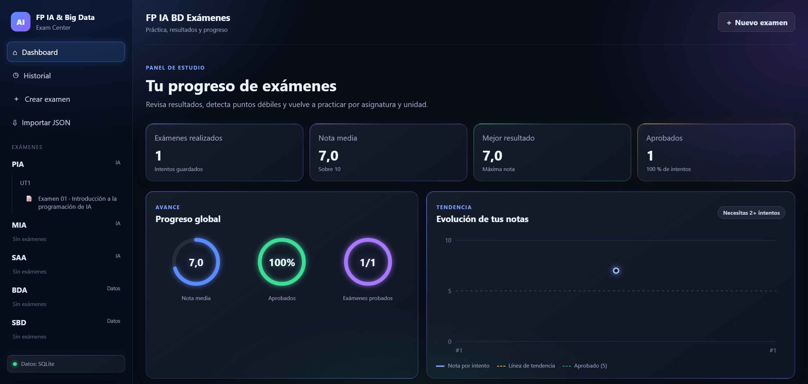
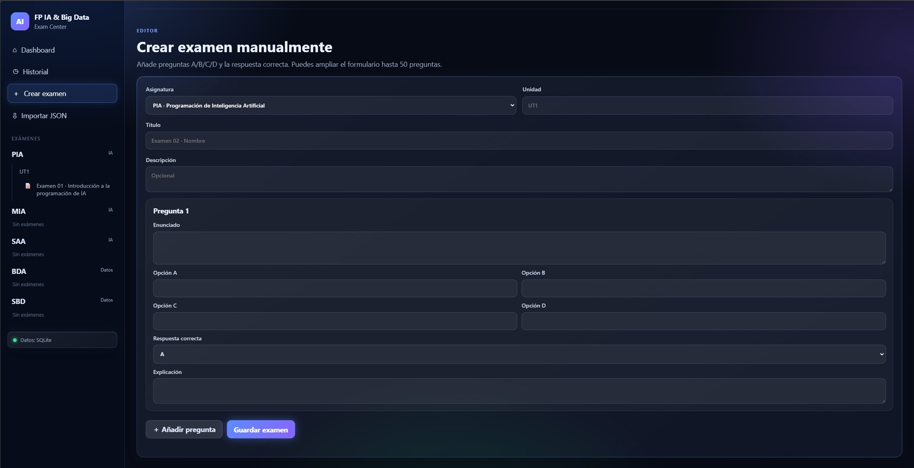
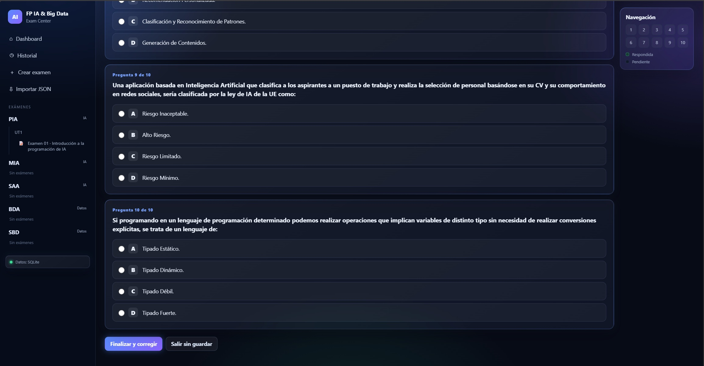
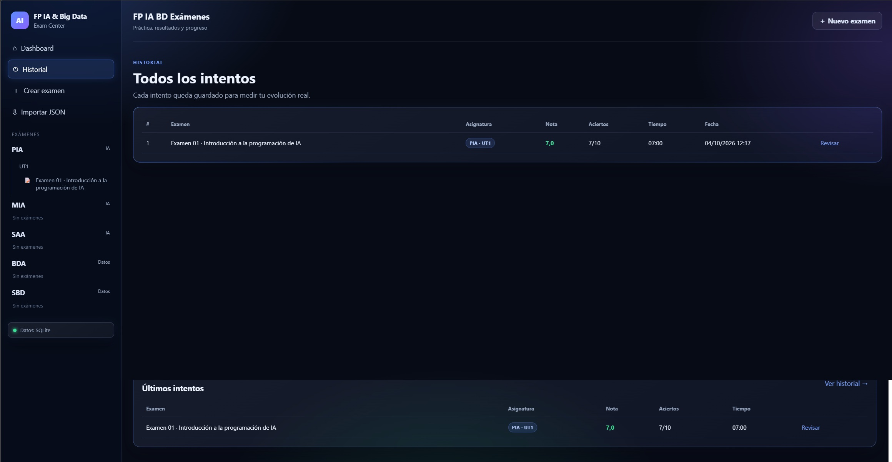
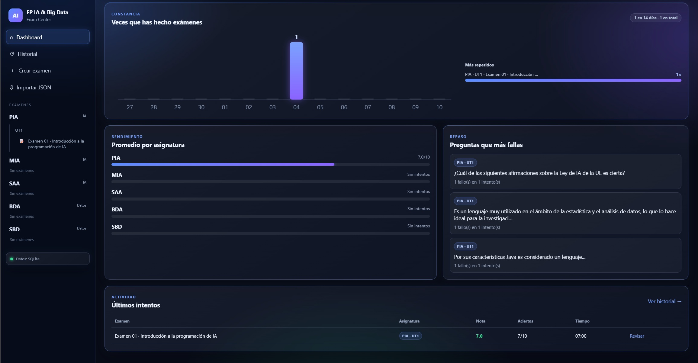
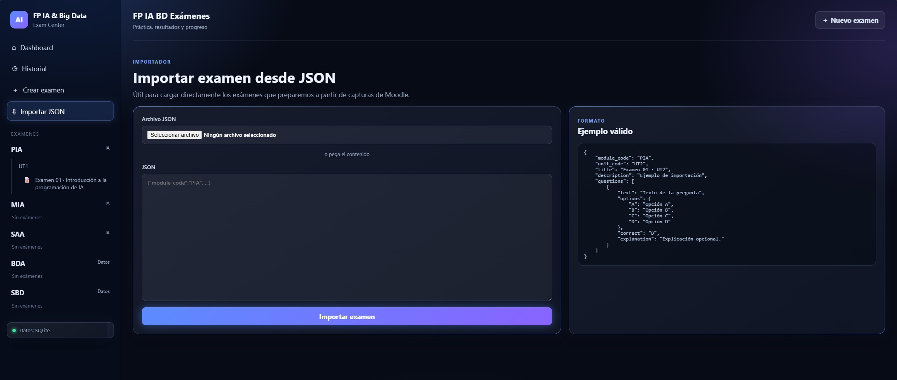

# EverTest — Plataforma de Exámenes y Autoaprendizaje


## Descripción general

**EverTest** es una aplicación web desarrollada con **PHP, JavaScript, HTML5 y CSS3**, diseñada para facilitar la preparación de exámenes, la autoevaluación y el seguimiento del aprendizaje.

Permite organizar asignaturas, crear e importar exámenes tipo test, realizar pruebas interactivas y analizar los resultados obtenidos.

El proyecto surge como una herramienta de apoyo para el estudio del **Curso de Especialización en Inteligencia Artificial y Big Data**, aunque su diseño permite utilizarlo en cualquier ámbito educativo o formativo.

Su objetivo principal es proporcionar un entorno de estudio práctico, organizado y accesible, donde el usuario pueda reforzar sus conocimientos mediante la repetición de exámenes y la revisión de errores.

---

## ¿Por qué EverTest?

EverTest busca mejorar la preparación de exámenes mediante herramientas de aprendizaje activo.

**Características principales:**

- Organización de exámenes por asignaturas y unidades.
- Creación manual de preguntas y exámenes.
- Importación de bancos de preguntas mediante archivos JSON.
- Realización de cuestionarios tipo test.
- Corrección de respuestas y consulta de resultados.
- Registro del historial de intentos.
- Estadísticas de rendimiento académico.
- Identificación y revisión de respuestas incorrectas.
- Repetición de exámenes completos o preguntas falladas.
- Almacenamiento local sin depender de servicios externos.
- Interfaz web para gestionar las actividades de estudio.

---

## Tecnologías utilizadas

| Área | Tecnologías |
|---|---|
| Backend | PHP 8.x |
| Frontend | HTML5, CSS3, JavaScript |
| Base de datos | SQLite |
| Almacenamiento alternativo | JSON |
| Intercambio de datos | JSON |
| Servidor de desarrollo | Servidor local PHP |
| Control de versiones | Git y GitHub |
| Entorno de desarrollo | Visual Studio Code |

---


## 📸 Capturas de pantalla

<table>
  <tr>
    <td width="50%" align="center" valign="top">
      <h3>Panel principal</h3>
      
    </td>
    <td width="50%" align="center" valign="top">
      <h3>Gestión de exámenes</h3>
      
    </td>
  </tr>
  <tr>
    <td width="50%" align="center" valign="top">
      <h3>Realización de exámenes</h3>
      
    </td>
    <td width="50%" align="center" valign="top">
      <h3>Resultados y estadísticas</h3>
      
    </td>
  </tr>
  <tr>
    <td width="50%" align="center" valign="top">
      <h3>DashBoard</h3>
      
    </td>
    <td width="50%" align="center" valign="top">
      <h3>Importación JSON</h3>
      
    </td>
  </tr>
</table>


---

## Funcionalidades principales

### 1. Panel de control (Dashboard)

El panel principal proporciona información sobre el progreso del usuario.

Permite consultar:

- Nota media obtenida.
- Exámenes realizados y aprobados.
- Mejores resultados.
- Rendimiento por asignaturas.

### 2. Gestión de asignaturas y exámenes

Permite organizar el contenido de estudio por módulos y unidades de aprendizaje.

El usuario puede mantener diferentes bancos de preguntas y acceder a los exámenes correspondientes.

### 3. Creación de exámenes

EverTest permite crear cuestionarios personalizados mediante preguntas y respuestas.

Esta funcionalidad facilita la preparación de pruebas adaptadas a las necesidades de estudio.

### 4. Importación de preguntas mediante JSON

La aplicación admite la importación de contenido estructurado mediante archivos JSON.

Esto facilita incorporar nuevos exámenes sin introducir manualmente cada pregunta.

### 5. Realización de exámenes

El usuario puede responder cuestionarios tipo test y obtener los resultados de su evaluación.

### 6. Historial y estadísticas

EverTest registra los intentos realizados para permitir el seguimiento del progreso.

Los resultados ayudan a identificar los contenidos que requieren mayor dedicación.

### 7. Revisión de errores

El sistema permite revisar las preguntas respondidas incorrectamente y reforzar los conocimientos mediante nuevas prácticas.

---

## Arquitectura del proyecto

EverTest utiliza una arquitectura de aplicación web basada en PHP, con una interfaz desarrollada mediante HTML, CSS y JavaScript.

El sistema separa la presentación, la lógica de aplicación y el almacenamiento de datos.

```text
                 USUARIO
                    |
                    v
             NAVEGADOR WEB
                    |
                    v
          INTERFAZ DE EVERTEST
          HTML + CSS + JavaScript
                    |
                    v
             BACKEND PHP
                    |
          +---------+---------+
          |         |         |
          v         v         v
       Gestión   Exámenes  Resultados
          |         |         |
          +---------+---------+
                    |
                    v
           CAPA DE DATOS
                    |
             +------+------+
             |             |
             v             v
           SQLite         JSON
```

**Principales componentes:**

- **Frontend:** presentación e interacción con el usuario.
- **Backend:** procesamiento de solicitudes y lógica de los exámenes.
- **Almacenamiento:** persistencia de preguntas, resultados y datos de la aplicación.
- **Importación:** incorporación de contenido mediante archivos JSON.

---

## Estructura del proyecto

```text
EverTest/
│
├── app/
│   ├── bootstrap.php
│   ├── helpers.php
│   ├── seed.php
│   └── storage.php
│
├── assets/
│   ├── css/
│   └── js/
│
├── data/
│
├── docs/
│
├── imports/
│
├── pages/
│
├── index.php
├── iniciar.bat
├── iniciar.sh
└── README.md
```

**Descripción de los directorios:**

- `app/`: lógica principal y gestión del almacenamiento.
- `assets/`: archivos CSS y JavaScript.
- `data/`: datos locales de la aplicación.
- `docs/`: documentación técnica y de usuario.
- `imports/`: archivos de importación de exámenes.
- `pages/`: páginas y vistas de la aplicación.
- `index.php`: punto de entrada principal.
- `iniciar.bat`: script de inicio para Windows.
- `iniciar.sh`: script de inicio para sistemas compatibles con Bash.

---

## Instalación y ejecución

### Requisitos previos

- PHP 8.x.
- Navegador web actualizado.
- Extensión SQLite de PHP para utilizar la base de datos SQLite.
- Git, opcional para clonar el repositorio.

### 1. Clonar el repositorio

```bash
git clone https://github.com/Diblock/EverTest.git
y pulsar iniciar.bat
```

### 2. Acceder al directorio

```bash
cd EverTest
```

### 3. Iniciar el servidor local

```bash
php -S localhost:8080
```

### 4. Abrir la aplicación

Desde el navegador, acceder a:

`http://localhost:8080`

La aplicación utiliza SQLite cuando está disponible y contempla almacenamiento alternativo mediante JSON.

---

## Seguridad y privacidad

EverTest está diseñado inicialmente como una aplicación de uso local y educativo.

Entre sus características y consideraciones se encuentran:

- Almacenamiento local de los datos.
- Funcionamiento sin servicios cloud obligatorios.
- Gestión local del historial de exámenes.
- Ausencia de necesidad de cuentas externas para el uso básico.

**Importante:** la aplicación se encuentra en desarrollo y no está preparada para exponerse directamente a Internet sin incorporar medidas adicionales de seguridad, autenticación y protección de datos.

---

## Futuras mejoras (Roadmap)

El proyecto continuará evolucionando mediante nuevas funcionalidades.

- [ ] Mejorar la gestión avanzada de bancos de preguntas.
- [ ] Incorporar estadísticas de aprendizaje más detalladas.
- [ ] Añadir diferentes modalidades de examen.
- [ ] Mejorar la experiencia de usuario en dispositivos móviles.
- [ ] Implementar autenticación y gestión de usuarios.
- [ ] Reforzar la seguridad para futuros despliegues web.
- [ ] Estudiar la integración de Inteligencia Artificial para generar preguntas y adaptar la dificultad de los exámenes.

Las funcionalidades de esta sección son propuestas de desarrollo futuro y no deben interpretarse como características ya implementadas.

---

## Objetivo del proyecto

EverTest tiene una doble finalidad.

**Educativa:** proporcionar una herramienta práctica para estudiar, realizar autoevaluaciones y reforzar conocimientos.

**Técnica:** desarrollar y mantener una aplicación web funcional aplicando conocimientos de programación, bases de datos, gestión de información y arquitectura de software.

El proyecto forma parte de un proceso de aprendizaje continuo y evolución profesional dentro del desarrollo de software y las tecnologías de Inteligencia Artificial y Big Data.

---

## Licencia

Este proyecto se distribuye bajo la **Licencia MIT**, permitiendo utilizar, modificar y distribuir el código conforme a sus condiciones.

La licencia se aplica al código propio del proyecto y no concede derechos sobre materiales académicos de terceros que pudieran importarse en la aplicación.

Consulta el archivo `LICENSE` para obtener más información.

---

## Sobre el desarrollador

**Desarrollado por Javier.**

Desarrollador de aplicaciones multiplataforma con formación en desarrollo de software, ciberseguridad e Inteligencia Artificial y Big Data.

Interesado en el desarrollo backend, la automatización, las arquitecturas de software y la creación de soluciones tecnológicas aplicadas a problemas reales.

### Contacto

[](https://github.com/Diblock)

[](https://www.linkedin.com/in/francisco-javier-jimenez-cortes-232137332/)

---

**EverTest — Aprende, practica y mejora.**
